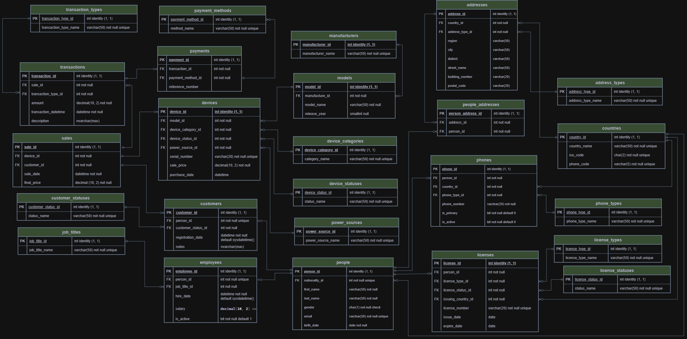

# devices_store_sql_db

After learning some database fundamentals, I created a simple devices_store_sql_db project, so I could apply all concepts I’ve learned in a practical way.

🎥 **[Watch the Video Walkthrough Here](https://youtu.be/p2RCfWMDEJ0)**

🗄️ Diagram:

# Technical Details

🛠️ Tools used: SSMS 2022 & MS SQL Server | Draw.io (for designing the ERD).

📂 Physical Directory: \
Separated the project into 5 directories: entities (12 core tables), lookups (12 reference tables), junctions (1 table), views (12 queries), and schema (diagram in .drawio and .png).

🗄️ Database & Schema: \
All database objects are housed inside the devices_store_db database under a dedicated ds schema (standing for devices_store) rather than defaulting to dbo to ensure clean namespace isolation.

📝 Coding Standards: \
Enforced lowercase snake_case for all identifiers, and used explicit constraint naming (e.g., pk_transactions_transaction_id) rather than random names.

📏 Data Sizing: \
Data types are strictly tailored to the domain, such as decimal(10, 2) for financial amounts (sale_price, amount), char(2) for fixed-length ISO country codes, bit for boolean flags (is_active), and nvarchar(max) for open-ended text fields.

# Relational Architecture: 

🔗 Lookup Table Normalization (1:N): \
Extracted static categories, such as device_types, phone_types, and power_sources, into 12 dedicated reference tables. By storing foreign key IDs in the core tables instead of raw text, the architecture prevents data entry anomalies and strictly enforces domain integrity.

👤 Supertype/Subtype Pattern (1:1): \
Separated the base-entity (ds.people) from the business-entity (ds.customers). I enforced a strict 1:1 relationship by placing a unique constraint on the foreign key (uq_customers_person_id), keeping the architecture modular.

🌉 Many-to-Many Relationship (M:N): \
A person can have home and work addresses, and multiple people can share the same home address. I implemented this mapping using the ds.people_addresses junction table, secured with a composite unique constraint on (person_id, address_id) to avoid duplicated records.

💳 Hierarchical Tracing (1:N): \
One sale can have multiple transactions, and each transaction maps to a specific payment method. This structure freezes the final_price at the time of sale, while allowing multiple payment methods to be tracked against a single transaction without data duplication.

# Constraints:

🔑 Primary Key Constraint: \
Uniquely identifies every row in entity, lookup, and junction tables (`pk_people_person_id`, pk_countries_country_id). And use int identity(1, 1), starting at seed 1 and incrementing by 1 for each new record.

🛡️ Foreign Key Constraint: \
Enforces referential integrity between parent and child tables so orphaned records cannot exist (linking ds.payments to ds.transactions and ds.payment_methods).

🛑 Unique Constraint: \
Prevents duplicate values in non-primary-key business columns, such as email addresses (uq_people_email), hardware serial numbers (uq_devices_serial_number), country names/codes (uq_countries_iso_code), and all lookup table names.

✅ Check Constraint: \
Restricts column values to a specific logical rule, such as chk_people_gender check (gender in ('m', 'f')) in ds.people to reject invalid character inputs.

⚙️ Default Constraint (default): \
Automates data entry when values are omitted during an insert, such as default sysdatetime() on registration_date, purchase_date, sale_date, and issuing_date, as well as default 0 on boolean flags in ds.phones.

⚖️ Nullability Constraints: \
Strictly separates mandatory fields (first_name varchar(50) not null) from optional fields (region varchar(50) null, notes nvarchar(max) null, release_year smallint null).
